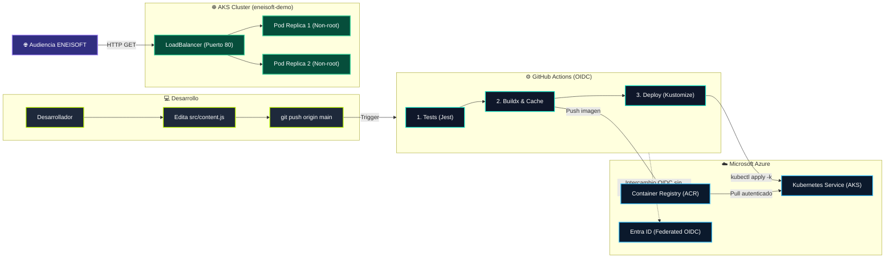

# Del Git Push a la Nube: Construye tu Primer Pipeline Automatizado

> **Demostración oficial para el ENEISOFT XVI** (Encuentro Nacional de Estudiantes de Ingeniería de Software)  
> **Track:** DevOps | **Fecha:** 03 de Noviembre, 19:00 – 20:00 (Virtual vía Google Meet)  
> **Ponente:** Miguel Solis (Practicante de Ingeniería de Software – Mibanco, GitHub Actions Certified GH-200)

---

## 🎯 Descripción del Proyecto

Este repositorio contiene una aplicación web completa y su canalización automatizada de Entrega Continua (CI/CD) de nivel profesional, diseñada pedagógicamente para estudiantes. Cada `git push` a la rama `main`:

1. Ejecuta suites de pruebas automatizadas con Jest.
2. Empaqueta la aplicación en una imagen de contenedor Docker optimizada multi-stage con usuario no-root.
3. Se autentica de forma segura con Microsoft Azure mediante **OpenID Connect (OIDC)**, eliminando por completo el uso de contraseñas o client secrets estáticos.
4. Publica la imagen en **Azure Container Registry (ACR)**.
5. Despliega la aplicación en **Azure Kubernetes Service (AKS)** utilizando **Kustomize**, asegurando alta disponibilidad con 2 réplicas balanceadas y sondas de salud.
6. Refleja los cambios en vivo en la página web con telemetría en tiempo real del pipeline y del clúster.

---

## 🏗️ Arquitectura de la Solución



*(El diagrama editable se encuentra en [`docs/pipeline-diagram.mmd`](file:///C:/Users/USUARIO/Desktop/eneisoft-pipeline-demo/docs/pipeline-diagram.mmd) para su uso en diapositivas).*

---

## 📂 Estructura del Repositorio

```text
eneisoft-pipeline-demo/
├── .github/
│   ├── workflows/
│   │   └── ci-cd.yml              # Pipeline principal (Test -> Build & Push -> Deploy)
│   └── dependabot.yml             # Automatización de parches para npm y GitHub Actions
├── docs/
│   ├── DEMO-SCRIPT.md             # Guion detallado minuto a minuto y plan B para la charla
│   ├── SECRETOS-Y-VARIABLES.md    # Explicación técnica de OIDC vs Client Secrets
│   └── pipeline-diagram.mmd       # Código Mermaid para las diapositivas
├── infra/
│   ├── setup-azure.sh             # Script para aprovisionar RG, ACR, AKS y OIDC
│   └── teardown-azure.sh          # Script para eliminar recursos y frenar costos
├── k8s/
│   ├── namespace.yaml             # Namespace 'eneisoft-demo'
│   ├── deployment.yaml            # Deployment de 2 réplicas con Downward API y Probes
│   ├── service.yaml               # Service tipo LoadBalancer (80 -> 3000)
│   └── kustomization.yaml         # Gestión declarativa de etiquetas de imagen
├── public/
│   ├── css/styles.css             # Estilos neón acordes al branding del evento
│   ├── js/app.js                  # Frontend vanilla: consulta /api/info y estado de GitHub
│   ├── assets/                    # Carpeta para colocar logos y foto del ponente
│   └── index.html                 # Página de aterrizaje de la demo
├── src/
│   ├── routes/
│   │   ├── api.js                 # Endpoints /api/info y /api/pipeline/latest
│   │   └── health.js              # Sondas /health (liveness) y /ready (readiness)
│   ├── services/
│   │   └── github.js              # Cliente API de GitHub con caché de 60s y fallback
│   ├── config.js                  # Centralización de variables de entorno
│   ├── content.js                 # ARCHIVO A EDITAR en la demo en vivo
│   └── server.js                  # Servidor Express con Helmet y graceful shutdown
├── tests/
│   ├── api-info.test.js           # Pruebas para /api/info
│   ├── api-pipeline.test.js       # Pruebas para /api/pipeline/latest
│   └── health.test.js             # Pruebas para las sondas de Kubernetes
├── Dockerfile                     # Construcción multi-stage en Node 22 Alpine (no-root)
└── package.json
```

---

## 🛠️ Requisitos Previos

- **Node.js**: v22 LTS (recomendado) o superior y `npm`.
- **Git** instalado.
- **Azure CLI (`az`)**: Versión 2.50+ instalada y con sesión iniciada (`az login`).
- **GitHub CLI (`gh`)** *(opcional, agiliza la carga de secretos)*.
- **Docker** *(opcional para pruebas de contenedores en local)*.

---

## 🚀 Guía Paso a Paso de Punta a Punta

### 1. Clonar y Probar en Local

```bash
# 1. Instalar dependencias
npm install

# 2. Correr las pruebas automatizadas
npm test

# 3. Iniciar el servidor local
npm start
# Abre en tu navegador: http://localhost:3000
```

---

### 2. Aprovisionar Infraestructura en Azure

El script [`infra/setup-azure.sh`](file:///C:/Users/USUARIO/Desktop/eneisoft-pipeline-demo/infra/setup-azure.sh) automatiza la creación de los recursos y la configuración federada OIDC sin requerir contraseñas.

> [!IMPORTANT]
> Modifica las variables iniciales dentro del script si deseas cambiar la región geográfica o el nombre de tus recursos.

```bash
# En sistemas Unix / WSL / Git Bash:
export GITHUB_ORG="<TU_USUARIO_O_ORGANIZACION>"
export GITHUB_REPO="eneisoft-pipeline-demo"
bash infra/setup-azure.sh
```

Al finalizar, el script imprimirá los 3 Secretos y las 3 Variables que debes configurar en GitHub.

---

### 3. Configurar GitHub Actions

En tu repositorio de GitHub, dirígete a:  
**Settings** → **Secrets and variables** → **Actions**.

#### 🔒 Repository Secrets (3):
- `AZURE_CLIENT_ID`: ID de la App Registration creada en Entra ID.
- `AZURE_TENANT_ID`: Tenant ID de tu suscripción de Azure.
- `AZURE_SUBSCRIPTION_ID`: ID de la suscripción de Azure.

#### 📦 Repository Variables (3):
- `ACR_NAME`: Nombre de tu Azure Container Registry (ej. `acreneisoftdemo`).
- `AKS_NAME`: Nombre del clúster AKS (ej. `aks-eneisoft-demo`).
- `RESOURCE_GROUP`: Nombre del grupo de recursos (ej. `rg-eneisoft-demo`).

*(Revisa [`docs/SECRETOS-Y-VARIABLES.md`](file:///C:/Users/USUARIO/Desktop/eneisoft-pipeline-demo/docs/SECRETOS-Y-VARIABLES.md) para más detalles).*

---

### 4. Ejecutar la Demo en Vivo

1. Abre el archivo [`src/content.js`](file:///C:/Users/USUARIO/Desktop/eneisoft-pipeline-demo/src/content.js) y modifica el mensaje:
   ```javascript
   message: '¡Saludos en vivo al ENEISOFT XVI! 🚀',
   ```
2. Realiza el commit y el push a la rama `main`:
   ```bash
   git add src/content.js
   git commit -m "feat: saludo en vivo ENEISOFT XVI"
   git push origin main
   ```
3. Observa en la pestaña **Actions** de GitHub la ejecución secuencial de los 3 jobs: `test` → `build-and-push` → `deploy`.
4. Al culminar el job `deploy`, entra al **Summary** del run para obtener la IP pública del LoadBalancer y abre la web en vivo.

*(Sigue el guion completo minuto a minuto en [`docs/DEMO-SCRIPT.md`](file:///C:/Users/USUARIO/Desktop/eneisoft-pipeline-demo/docs/DEMO-SCRIPT.md)).*

---

### 5. Limpieza de Recursos (Teardown)

Para evitar consumos de saldo en Azure al finalizar la presentación:

```bash
bash infra/teardown-azure.sh
```

---

## 🔍 Solución a los 5 Errores Más Comunes (Troubleshooting)

### 1. `AADSTS70021: No matching federated identity record found for subject...`
- **Causa:** El "Subject" configurado en el Federated Credential de Azure Entra ID no coincide exactamente con el repositorio o la rama que ejecuta el pipeline.
- **Solución:** Verifica que el subject registrado sea idéntico a:
  `repo:<USUARIO>/<REPO>:ref:refs/heads/main`
  Si estás usando Environments de GitHub (ej. `environment: production`), debes crear un federated credential adicional con el subject `repo:<USUARIO>/<REPO>:environment:production` (el script `setup-azure.sh` incluye ambos).

---

### 2. `Error: OpenIDConnect: id-token not present in environment or credentials`
- **Causa:** El job de GitHub Actions no tiene permisos explícitos para solicitar el token OIDC al emisor de GitHub.
- **Solución:** Asegúrate de que el workflow declare en el nivel del job:
  ```yaml
  permissions:
    id-token: write
    contents: read
  ```
  Por defecto, los repositorios nuevos restringen este token a menos que se declare explícitamente.

---

### 3. `ImagePullBackOff` o `ErrImagePull` en los Pods de AKS
- **Causa:** AKS no tiene permisos delegados para descargar imágenes del registro ACR privado.
- **Solución:**
  Ejecuta el comando de vinculación administrada:
  ```bash
  az aks update --name <AKS_NAME> --resource-group <RESOURCE_GROUP> --attach-acr <ACR_NAME>
  ```
  Esto asigna automáticamente el rol `AcrPull` a la identidad administrada del kubelet de AKS.

---

### 4. `Error: kubelogin convert-kubeconfig failed` o problemas con Azure RBAC
- **Causa:** Si el clúster AKS fue creado con autenticación integrada de Microsoft Entra ID, las herramientas tradicionales de `kubectl` fallan porque requieren el plugin interactivo de `kubelogin`.
- **Solución:** Nuestro pipeline incluye la detección e instalación automática de `kubelogin` mediante:
  ```bash
  sudo az aks install-cli
  kubelogin convert-kubeconfig -l azurecli
  ```
  Si realizas pruebas manuales en tu terminal local, instala `kubelogin` con `az aks install-cli` o `winget install Microsoft.Kubelogin`.

---

### 5. Service en Kubernetes muestra `<pending>` en la columna `EXTERNAL-IP`
- **Causa:** Al crear un Service de tipo `LoadBalancer` en Azure, el Cloud Controller Manager tarda entre 60 y 120 segundos en aprovisionar la IP pública en el Azure Load Balancer.
- **Solución:** Es un comportamiento normal durante la creación inicial. El pipeline incluye un bucle de espera activa con reintentos para extraer la IP en el `$GITHUB_STEP_SUMMARY`. Puedes monitorearlo con:
  ```bash
  kubectl get svc -n eneisoft-demo -w
  ```
