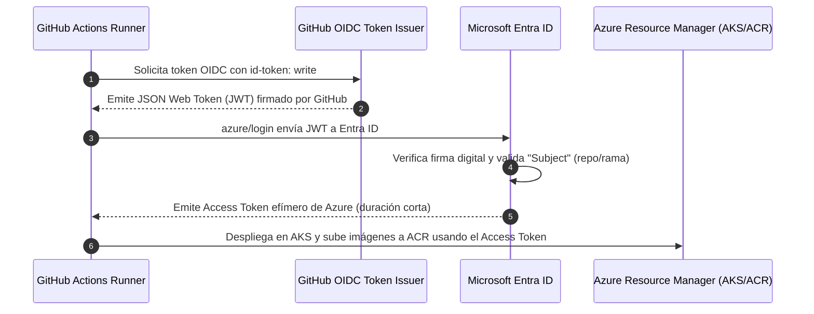

# Gestión de Secretos, Variables y Autenticación OIDC

Este documento detalla la separación estricta entre **Secretos** y **Variables** en el pipeline de GitHub Actions, así como el fundamento técnico y de seguridad detrás del uso de **OpenID Connect (OIDC)** frente a credenciales tradicionales basadas en `client_secret`.

---

## 1. Tabla de Configuración en GitHub

En GitHub, ve a **Settings** → **Secrets and variables** → **Actions**.

### 🔒 Repository Secrets (Solo 3 valores, sin contraseñas)

Los secretos se almacenan cifrados mediante libsodium y se enmascaran automáticamente en los logs del runner.

| Nombre del Secreto | Ejemplo / Formato | Propósito | ¿Por qué es un Secreto? |
|---|---|---|---|
| `AZURE_CLIENT_ID` | `11111111-2222-3333-4444-555555555555` | ID de la App Registration en Microsoft Entra ID | Identifica la entidad de seguridad autorizada para solicitar tokens de acceso. |
| `AZURE_TENANT_ID` | `aaaaaaaa-bbbb-cccc-dddd-eeeeeeeeeeee` | ID del Directorio / Inquilino de Microsoft Entra ID | Identifica el tenant de la organización en Azure. |
| `AZURE_SUBSCRIPTION_ID` | `00000000-0000-0000-0000-000000000000` | ID de la suscripción de Azure donde viven los recursos | Determina el ámbito de facturación y gobernanza de los recursos. |

> [!NOTE]
> Nota que **ninguno de estos tres valores es una contraseña o un token privado**. Son identificadores públicos (GUIDs) que solo cobran valor cuando GitHub firma criptográficamente la solicitud OIDC desde tu repositorio específico.

---

### 📦 Repository Variables (Valores públicos de configuración)

Las variables están disponibles en texto claro tanto en la interfaz como en los scripts del pipeline vía `${{ vars.VARIABLE }}`.

| Nombre de la Variable | Valor Típico | Propósito |
|---|---|---|
| `ACR_NAME` | `acreneisoftdemo` | Nombre del registro privado de contenedores en Azure Container Registry. |
| `AKS_NAME` | `aks-eneisoft-demo` | Nombre del clúster administrado en Azure Kubernetes Service. |
| `RESOURCE_GROUP` | `rg-eneisoft-demo` | Nombre del Resource Group que contiene todos los recursos en Azure. |
| `ENABLE_TRIVY` | `false` *(opcional)* | Bandera para activar/desactivar el análisis DevSecOps de imágenes con Trivy. |

---

## 2. ¿Por qué OIDC en lugar del JSON con Client Secret?

Históricamente, la autenticación entre GitHub Actions y Azure requería generar un **Service Principal** con una contraseña estática (`client_secret`), empaquetada en un bloque JSON conocido como `AZURE_CREDENTIALS`:

```json
// ❌ ENFOQUE OBSOLETO Y DE ALTO RIESGO:
{
  "clientId": "...",
  "clientSecret": "s3cr3t0_d3_l4rg4_dur4c10n_q|_|3_p|_|3d3_f1ltr4rs3",
  "subscriptionId": "...",
  "tenantId": "..."
}
```

### Comparativa: Credenciales Estáticas vs. OIDC Federado

| Criterio | Enfoque Tradicional (`client_secret`) | Enfoque Moderno (**OIDC Federado**) |
|---|---|---|
| **Almacenamiento de secretos** | Secreto de larga duración (meses/años) guardado en GitHub. | **Cero contraseñas guardadas**. Solo IDs públicos. |
| **Riesgo de filtración** | Si el secreto se expone, un atacante tiene acceso total hasta que expire o se revoque manualmente. | No hay secreto que robar; los tokens emitidos duran solo unos minutos y solo funcionan dentro del runner. |
| **Ciclo de vida de tokens** | Estático y persistente. | **Efímero y dinámico** (máximo 60 minutos, acotado a la ejecución del job). |
| **Mantenimiento operativo** | Requiere rotación periódica obligatoria de claves para cumplir auditorías. | **Mantenimiento cero**: no hay fechas de caducidad que rompan la demo o la producción. |
| **Auditoría e identidad** | En Azure solo se ve que el Service Principal actuó. | Los logs de Microsoft Entra ID registran el repositorio exacto, rama, commit y run_id que solicitó el token. |

---

## 3. ¿Cómo funciona el intercambio criptográfico OIDC?

El flujo de autenticación sin secretos se ejecuta en 5 pasos automáticos:



### Elementos clave del JWT emitido por GitHub:
- **`iss` (Issuer):** `https://token.actions.githubusercontent.com`
- **`aud` (Audience):** `api://AzureADTokenExchange`
- **`sub` (Subject):** `repo:<OWNER>/<REPO>:ref:refs/heads/main`

Microsoft Entra ID solo otorga acceso si el token proviene de la autoridad de GitHub y si el `sub` coincide exactamente con la regla federada que configuraste en `setup-azure.sh`. Si alguien clona tu código o ejecuta el workflow desde un fork no autorizado, Microsoft rechazará la solicitud inmediatamente.
